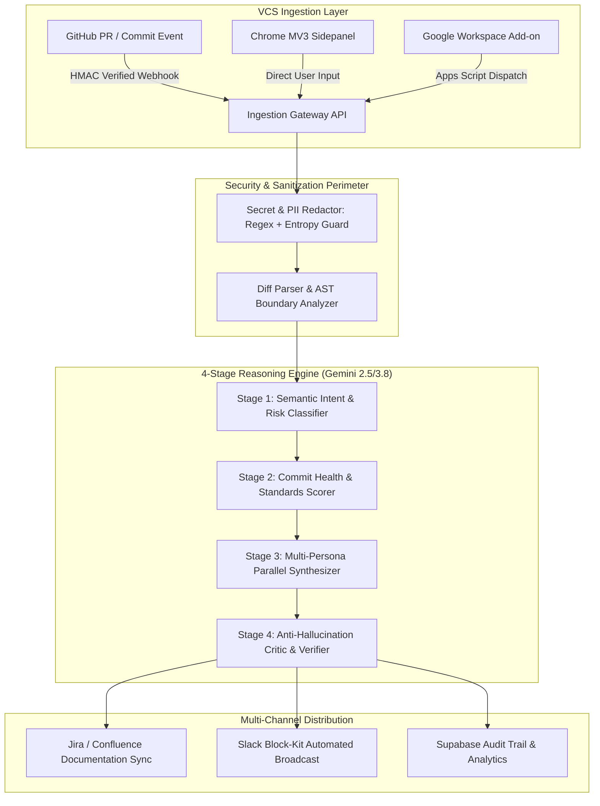

# 🚀 ShipIt AI

> **Multi-Surface Developer Intelligence & Automated Release Orchestration Platform**  
> *Transforming raw code diffs and commit histories into stakeholder-ready changelogs, executive briefs, and release notes across Web, Chrome MV3, and Google Workspace.*

[](https://github.com/Coder-0X/ShipIt-AI/actions/workflows/ci.yml)
[](https://opensource.org/licenses/MIT)
[](https://nextjs.org/)
[](https://www.typescriptlang.org/)
[](https://ai.google.dev/)
[](https://jestjs.io/)

---

## 📌 Overview

**ShipIt AI** bridges the communication divide between software engineering teams and product stakeholders. Rather than requiring developers to manually write release notes, sprint summaries, and Jira issue descriptions, ShipIt AI ingests raw Git diffs, parses Abstract Syntax Trees (AST), redacts secrets/PII, and runs a **4-stage deep reasoning pipeline** powered by Google Gemini to synthesize multi-persona release documentation.

ShipIt AI operates across **three native developer surfaces**:
1. **Enterprise Web Dashboard & Webhook Microservice** (`/web`): Next.js 16 full-stack application with real-time GitHub PR webhook processing, automated Slack broadcasting, and audit logging.
2. **Chrome MV3 Sidepanel Extension** (`/extension`): Real-time browser extension that transforms unformatted release snippets directly inside GitHub, Jira, and Slack.
3. **Google Workspace Add-on** (`/workspace-addon`): Google Apps Script add-on embedding release note generation directly into Google Docs and Gmail drafts.

---

## 🏛️ System Architecture



---

## ✨ Core Features & Technical Highlights

### 1. Abstract Syntax Tree (AST) & Diff Boundary Engine
- **Intelligent File Filtering**: Automatically skips noise like `package-lock.json`, minified bundles, lockfiles, and binary assets before tokenization.
- **Context-Preserving Chunking**: Parses hunk headers (`@@ -line,count +line,count @@`) to extract relevant function scopes rather than arbitrary line cuts.

### 2. Multi-Persona Synthesis Engine
Generates tailored communication for distinct organizational tiers from a single code diff:
- **Executive Summary**: High-level strategic impacts, business value, and ROI.
- **Product & Customer-Facing**: User-friendly feature announcements and changelog items.
- **Engineering & QA**: Breaking changes, database migration risks, modified APIs, and test coverage suggestions.

### 3. Enterprise Security & PII Redaction
- Zero-trust token hygiene.
- Pre-processing layer wipes high-entropy API keys (OpenAI, AWS, Stripe, GitHub PATs), IP addresses, and customer emails before LLM ingestion.

### 4. Cross-Platform Developer Surfaces
| Component | Technology | Description |
| :--- | :--- | :--- |
| **Web Platform** | Next.js 16, TypeScript, TailwindCSS v4 | Full-stack application with REST/Webhook APIs, Supabase DB, and Stripe billing |
| **Chrome Extension** | Manifest V3, Webpack, Chrome SidePanel API | Contextual assistant for browser-based code reviews and release notes |
| **Google Workspace** | Apps Script, HTML5/CSS3 | Integrated sidebar for Google Docs sprint planning and Gmail executive dispatch |
| **Core Engine** | TypeScript, Jest, Google GenAI SDK | Modular reasoning pipeline with 100% test coverage for AST chunking |

---

## 📂 Repository Structure

```
ShipIt-AI/
├── .github/workflows/       # GitHub Actions automated CI/CD pipeline
│   └── ci.yml
├── docs/                    # Technical architecture & enterprise specs
│   ├── enterprise_jira_architecture_spec.md
│   └── product_roadmap.md
├── extension/               # Chrome MV3 Sidepanel Extension
│   ├── manifest.json
│   ├── service-worker.js
│   ├── sidepanel.html
│   └── sidepanel.js
├── web/                     # Full-stack Next.js 16 application
│   ├── src/
│   │   ├── app/             # App router pages & API endpoints
│   │   │   ├── api/generate/           # LLM generation endpoint
│   │   │   ├── api/enterprise/         # PR analysis & audit routes
│   │   │   └── api/webhooks/github/    # GitHub Webhook handler
│   │   ├── engine/          # AST chunker, sanitizer, scorer & pipeline
│   │   │   ├── ast.ts
│   │   │   ├── sanitizer.ts
│   │   │   ├── scorer.ts
│   │   │   └── pipeline.ts
│   │   └── lib/             # Supabase, Slack, and rate limiter clients
│   ├── package.json
│   ├── tsconfig.json
│   └── jest.config.js
└── workspace-addon/         # Google Workspace Apps Script Add-on
    ├── appsscript.json
    ├── Code.gs
    └── Sidebar.html
```

---

## 🚀 Getting Started

### Prerequisites
- **Node.js**: v18.0.0 or higher
- **npm** or **pnpm**
- **Google Gemini API Key** ([Google AI Studio](https://aistudio.google.com/))

### 1. Web Application Setup

```bash
# Clone the repository
git clone https://github.com/Coder-0X/ShipIt-AI.git
cd ShipIt-AI/web

# Install dependencies
npm install

# Configure environment variables
cp .env.example .env.local
# Open .env.local and add your GEMINI_API_KEY

# Run test suite
npm test

# Start development server
npm run dev
```

Open [http://localhost:3000](http://localhost:3000) to access the web console.

### 2. Loading the Chrome MV3 Extension

1. Open Google Chrome and navigate to `chrome://extensions/`.
2. Enable **Developer mode** (toggle in top-right corner).
3. Click **Load unpacked** and select the `ShipIt-AI/extension` folder.
4. Pin the ShipIt AI extension and open the side panel to start generating releases.

### 3. Deploying the Google Workspace Add-on

1. Navigate to [Google Apps Script](https://script.google.com/).
2. Create a new project.
3. Copy `workspace-addon/Code.gs`, `workspace-addon/Sidebar.html`, and `workspace-addon/appsscript.json` into the editor.
4. Click **Deploy** > **Test deployments** to install on your Google account.

---

## 🧪 Testing & Quality Assurance

ShipIt AI maintains automated testing for the AST processing and sanitization engine:

```bash
cd web
npm test
```

Expected output:
```text
PASS src/engine/__tests__/ast.test.ts
  AST Chunker & Filter
    ✓ should filter out lockfiles (package-lock.json)
    ✓ should handle empty diffs gracefully

Test Suites: 1 passed, 1 total
Tests:       2 passed, 2 total
```

---

## 🛡️ Security & Privacy

- **No Code Storage**: Code diffs processed via the API are never stored without explicit user consent.
- **Redaction Pipeline**: Heuristic filters mask API tokens and secrets before forwarding to LLM endpoints.
- **Zero Secret Commits**: Environment files and keys are excluded via comprehensive `.gitignore` rules.

---

## 📄 License

Distributed under the **MIT License**. See `LICENSE` for more information.

---

## 👨‍💻 Author

**Asim Paudel**  
- GitHub: [@Coder-0X](https://github.com/Coder-0X)  
- Email: [asimpaudel48@gmail.com](mailto:asimpaudel48@gmail.com)
