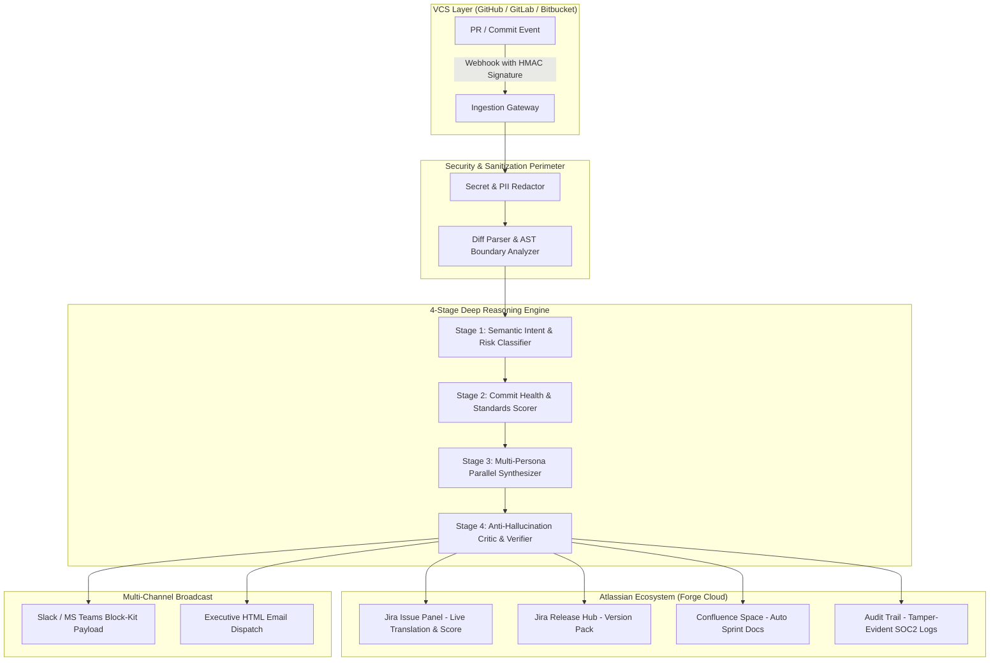

# Enterprise Jira & VCS AI Platform: Technical Architecture & Specification

## 1. High-Level System Topology



---

## 2. Security & Data Sanitization Layer (Zero-Trust Enterprise Standard)

Enterprises will immediately reject any AI tool that streams raw code to an external API without strict sanitization. Before any diff or commit data touches the reasoning models, it passes through the **Sanitization Perimeter**:

```
Raw Git Diff / Notes
        │
        ▼
[ 1. High-Entropy Secret Scanner ]  ──► Replaces API keys, JWTs, AWS credentials with [REDACTED_SECRET]
        │
        ▼
[ 2. PII / Email / IP Redactor ]    ──► Replaces customer emails, IPv4/v6, internal IPs with [REDACTED_PII]
        │
        ▼
[ 3. AST Diff Truncation & Chunking]──► Filters out lockfiles (package-lock.json, yarn.lock), generated binaries, minified bundles
        │
        ▼
Sanitized Diff Context ready for LLM Analysis
```

---

## 3. The 4-Stage Deep Reasoning Engine

To justify enterprise contract values ($2.50 to $6.00/user/month), we do not use simple zero-shot prompts. We utilize a **4-Stage Multi-Agent Reasoning Pipeline** with specialized models and temperature parameters:

### Stage 1: Semantic Intent & Security/Risk Classifier
*   **Role:** Analyzes the actual modified files and code diffs to determine the engineering impact and risk level.
*   **Calculations:**
    *   *Blast Radius:* Core infrastructure vs UI styling vs configuration vs database migrations.
    *   *Security Impact:* Flags changes to authentication routes, permission checks, cryptographic libraries, or environment variables.
    *   *Breaking Changes:* Detects deprecated API endpoints, schema column removals, or changed function signatures.

### Stage 2: Conventional Commit & Documentation Quality Scorer
*   **Role:** Computes a deterministic 1–100 **PR Health Score** based on:
    *   Conventional Commit syntax (`feat`, `fix`, `refactor`, `perf`, `test`, `docs`, `chore`).
    *   Imperative mood and descriptive clarity.
    *   Issue Key Binding (e.g., verifies valid Jira issue key like `PROJ-1024` in branch name / commit header).
*   **Jira Workflow Enforcement:** Exposes boolean triggers for Jira Workflow Validators (e.g., block ticket status transition if Health Score < 70).

### Stage 3: Multi-Persona Synthesis
Runs parallel specialized prompts to produce exact tailored views:
1.  **Product / Customer Success View:** Translates low-level mechanics into end-user value, answering: *"What can our customers do now that they couldn't do before?"*
2.  **Engineering / Architecture View:** Precise technical changelog highlighting migrations, dependencies, deprecations, and performance deltas.
3.  **Executive Briefing View:** 2-sentence high-level summary of sprint progress for Directors and VPs.
4.  **Compliance & Audit View:** Formal change management audit log stating the business purpose, risk categorization, and affected systems.

### Stage 4: Anti-Hallucination Critic & Verifier
*   **Role:** An independent evaluation pass that cross-references the generated release copy against the ground-truth git diff.
*   **Checks:**
    *   *False Feature Claims:* Ensures the copy does not promise functionality absent from the code.
    *   *Tone Alignment:* Removes any lingering AI clichés or promotional exaggeration.
    *   *Formatting Integrity:* Validates Atlassian Document Format (ADF), Markdown, and Slack Block-Kit JSON syntax.

---

## 4. Atlassian Forge Integration Blueprint

### Manifest Modules (`manifest.yml`)
1.  **`jira:issuePanel`**: Renders the AI summary, quality score badge, and plain-English translation directly inside the Jira ticket sidebar.
2.  **`jira:projectSettings`**: Project-level controls for tone customization, Confluence target spaces, and BYOK (Bring Your Own Key) configuration.
3.  **`jira:releaseHub`**: Version-level release pack generator button that aggregates all tickets in a release.
4.  **`confluence:contentAction` / REST Integration**: Automatically writes structured sprint release documentation to Confluence.
5.  **`webtrigger` / Backend API**: Secure HMAC-authenticated webhook endpoint for GitHub/GitLab events.

---

## 5. Implementation Roadmap

| Phase | Milestone | Deliverable |
| :--- | :--- | :--- |
| **Phase 1** | **Core Reasoning Engine** | TypeScript engine with secret sanitizer, AST diff analyzer, and 4-stage reasoning pipeline. |
| **Phase 2** | **Jira Issue Panel (Forge UI)** | Interactive Forge Custom UI React component showing real-time score, plain-English summary, and copy triggers. |
| **Phase 3** | **Release Hub & Multi-Channel** | Version aggregation engine + Confluence documentation creator + Slack Block-Kit dispatcher. |
| **Phase 4** | **Audit & Compliance Module** | SOC 2 / ISO 27001 Change Traceability Matrix exporter (PDF/JSON). |
